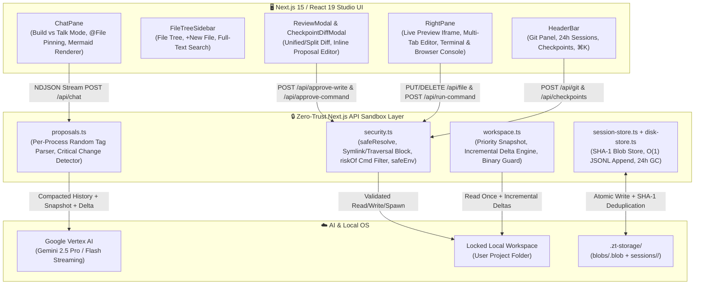
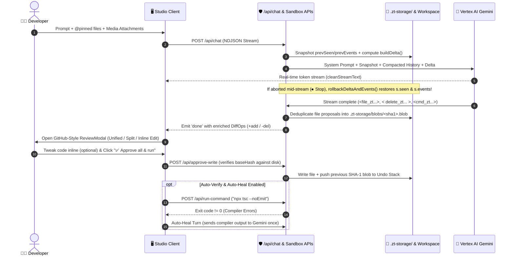
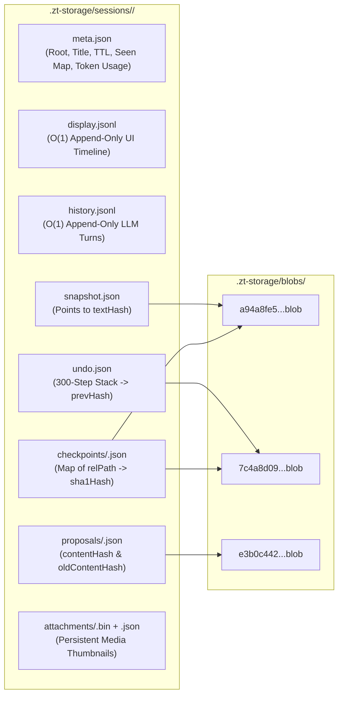

# 🛡️ Zero-Trust AI Studio (Next.js 15 + React 19 + Vertex AI Gemini)

> **A Permission-Gated, Self-Healing Full-Stack AI App Builder & Sandbox IDE**  
> Built with Next.js 15 App Router, React 19, TypeScript, Tailwind CSS, and Google Vertex AI (`@google/genai`).

---

## 🌟 Why This Project Stands Out (Executive Summary)

Most AI coding assistants either run in cloud containers disconnected from your local toolchain or require unrestricted write/shell access to your machine. **Zero-Trust AI Studio** solves this by combining **local workspace execution** with a strict **Zero-Trust, Human-in-the-Loop (HITL) security boundary**:

1. **Zero Unapproved Mutations**: The AI *cannot* write files, delete files, or execute shell commands directly. Every proposed operation is intercepted, parsed using per-process cryptographic XML tags, and staged in a GitHub-style unified/split diff viewer for human approval or inline editing.
2. **Content-Addressable Disk Engine (`.zt-storage/`)**: Every workspace snapshot, file proposal, undo state, and checkpoint is deduplicated using **SHA-1 content-addressable blobs** (`blobs/<sha1>.blob`) and append-only JSONL streams (`display.jsonl`, `history.jsonl`) with a 24-hour TTL janitor.
3. **Closed-Loop Self-Healing (`Auto-Verify` + `Auto-Heal`)**: When enabled, approving file changes automatically runs `npx tsc --noEmit` in the sandbox terminal and feeds compiler errors back to the AI for a 1-retry autonomous fix.
4. **Live Browser Console Telemetry Bridge**: The sandbox preview iframe injects a lightweight error/console bridge (`postMessage`) that captures runtime exceptions and lets you send them to the AI with one click (**🩹 Fix Browser Errors with AI**).

---

## 🏗️ System Architecture



---

## 🔄 Human-in-the-Loop (HITL) & Self-Healing Workflow



---

## 💾 Content-Addressable Storage Architecture (`.zt-storage/`)

To prevent RAM bloat and survive browser refreshes, laptop sleep/wake cycles, or server restarts, Zero-Trust Studio uses a custom content-addressable storage engine:



- **Zero Duplication**: If 15 checkpoints share 98% of the same files, each unchanged file is stored **only once** in `.zt-storage/blobs/<sha1>.blob`.
- **O(1) Chat Persistence**: Each completed turn appends two lines to `display.jsonl` and `history.jsonl` via `appendChatTurnToDisk()` instead of rewriting multi-megabyte JSON files.
- **Sliding-Window Context Compaction**: Keeps 100% of chat turns on disk for 24 hours, while automatically compacting older turns into an architectural summary + the 6 most recent full turns when calling Gemini.

---

## 🛡️ Zero-Trust Security Guarantees

| Threat Vector | Mitigation Engineered in `src/lib/security.ts` & `src/lib/config.ts` |
| :--- | :--- |
| **Path Traversal & Symlink Escape** | `safeResolve()` normalizes paths, blocks `..`, checks every path segment via `fs.lstatSync()` to reject symbolic links, and verifies `fs.realpathSync()` stays strictly inside the locked workspace root. |
| **Prompt Injection via File Contents** | Proposal XML tags use a per-process random cryptographic suffix (`<file_zt9f2a1b>`, `<cmd_zt9f2a1b>`) generated at boot so malicious text inside project files can never spoof tool tags. |
| **Destructive Shell Commands** | `riskOf()` blocks multiline command injection (`[\r\n]`), `sudo`, `rm -rf`, PowerShell `-Recurse`, raw network tools (`nc`, `socat`), piped downloads (`curl \| sh`), `git push/remote/config`, and parent-directory `cd ..`. |
| **Secret & Credential Exfiltration** | `.env*` files (except `.example`/`.sample`), `.git`, `node_modules`, `.npmrc`, and `vertex_credentials.json` are blocked from both AI snapshots and file writes. `safeEnv()` strips `KEY`, `TOKEN`, `SECRET`, `PASSWORD`, `AWS_`, `GCP_`, and `GITHUB_` variables from spawned child processes. |
| **Orphaned Background Processes** | `killTree()` spawns commands in detached POSIX process groups and escalates from `SIGTERM` to `SIGKILL` after 1.5s (or `taskkill /T /F` on Windows) so stopping a server kills all child processes. |
| **Stale File Overwrites** | Every `FileProposal` records `baseHash = sha1(oldContent)`. If a file changes on disk before approval, `/api/approve-write` returns `409 Conflict (stale: true)` and prompts for confirmation. |

---

## ✨ Key Developer Experience (DX) Features

- **🔨 Build Mode vs. 💬 Talk / Plan Mode**:
  - **Build Mode**: Proposes full file writes, deletions, and terminal commands with a **Critical Change Confirmation Gate** for core config files (`package.json`, `tsconfig.json`, `next.config.*`) and file deletions.
  - **Talk / Plan Mode**: Disables file writes and renders interactive **Mermaid.js architecture diagrams** directly in chat with a one-click **⚡ Switch to Build & Implement Plan** button.
- **👀 GitHub-Style Diff Viewer & Inline Proposal Editor (`ReviewModal.tsx`)**:
  - Switch between **Unified** and **Split (Side-by-Side)** diffs with word-level highlighting, collapsible unchanged line gaps, keyboard navigation (`j` / `k`), and an **✏️ Edit Proposal** mode to tweak AI code before saving to disk.
- **📝 Multi-Tab Docked Code Editor (`RightPane.tsx`)**:
  - Edit multiple workspace files with line numbers, dirty-state indicators (`•`), `Ctrl+S` / `Cmd+S` saving, `beforeunload` unsaved-tab protection, and automatic tab synchronization on Undo or Checkpoint restore.
- **🌿 Built-In Git Source Control (`HeaderBar.tsx`, `/api/git`)**:
  - Initialize repos (`git init`), switch or create branches, inspect uncommitted changes, stage & commit, or click **✨ AI Commit** to have Gemini inspect `git diff` and propose a Conventional Commit command.
- **📌 `@file` Context Pinning & Command Palette (`Ctrl+K` / `Cmd+K`)**:
  - Type `@` in the chat box to autocomplete and pin fresh file contents into the prompt, or press `Ctrl+K` to fuzzy-search files, toggle windows, run terminal macros, or manage checkpoints.

---

## 🚀 Getting Started

### 1. Prerequisites
- **Node.js** 18.18+ (Node 20+ recommended)
- **Google Cloud Vertex AI** project with Gemini API enabled (`vertex_credentials.json` in the project root or `GOOGLE_APPLICATION_CREDENTIALS` set in your environment)

### 2. Installation
```bash
npm install
```

### 3. Run the Development Server
```bash
npm run dev
```
- Starts on `http://localhost:3005` (and automatically falls back to the next available port `3006+` via `scripts/start-next.mjs` if port `3005` is busy).

### 4. Run Automated Verification & Type Checks
```bash
npm test
npx tsc --noEmit
```

---

## 📂 Project Structure

```text
├── scripts/
│   ├── start-next.mjs         # Auto-port-finding Next.js launcher (starts at 3005)
│   └── verify-studio.mjs      # Automated verification suite (attachments, abort rollback, security)
├── src/
│   ├── app/
│   │   ├── api/
│   │   │   ├── chat/          # Streaming Vertex AI Gemini endpoint + compaction + abort rollback
│   │   │   ├── approve-write/ # SHA-1 baseHash verification + atomic file write + Undo blob push
│   │   │   ├── approve-command/# Sandboxed process spawner + preview URL auto-detector
│   │   │   ├── checkpoints/   # Deduplicated SHA-1 workspace checkpoints (create, diff, restore)
│   │   │   ├── file/          # Studio multi-tab editor GET / PUT / DELETE endpoints
│   │   │   ├── git/           # Git status, branch switcher, commit & diff-summary API
│   │   │   ├── preview/       # Static HTML/asset server + <base> rewrite + console telemetry bridge
│   │   │   ├── sessions/      # 24h session switcher, rename, Blob GC & full storage wipe
│   │   │   └── undo/          # Turn-grouped multi-file Undo engine
│   │   ├── globals.css        # Tailwind + GitHub diff table styles
│   │   └── page.tsx           # Main Studio orchestrator & state synchronization
│   ├── components/
│   │   ├── HeaderBar.tsx      # Top bar: Workspace lock, Git panel, Sessions, Checkpoints, Windows
│   │   ├── FileTreeSidebar.tsx# Collapsible file explorer + workspace-wide code search
│   │   ├── ChatPane.tsx       # Streaming Markdown + Mermaid renderer + @file autocomplete
│   │   ├── RightPane.tsx      # Responsive Live Preview + Multi-Tab Editor + Terminal/Console
│   │   ├── ReviewModal.tsx    # Unified/Split diff viewer + inline proposal code editor
│   │   ├── CheckpointDiffModal.tsx # Side-by-side workspace vs. checkpoint diff modal
│   │   └── CommandPaletteModal.tsx # Ctrl+K / Cmd+K developer command palette
│   ├── lib/
│   │   ├── config.ts          # Context budgets, allowed extensions, per-process random tag keys
│   │   ├── diff.ts            # Myers/LCS line diff & word-level highlight algorithm
│   │   ├── disk-store.ts      # .zt-storage/ SHA-1 blob store, JSONL logger & 24h GC janitor
│   │   ├── proposals.ts       # XML tag parser, critical change detector & system prompts
│   │   ├── security.ts        # safeResolve, symlink blocker, riskOf command filter, safeEnv
│   │   ├── session-store.ts   # In-memory + disk session lifecycle & process-tree termination
│   │   └── workspace.ts       # Priority-sorted snapshot builder & incremental delta tracker
│   └── types/
│       └── builder.ts         # Complete TypeScript interfaces
└── CHANGELOG.md               # Detailed engineering changelog for technical interviews
```