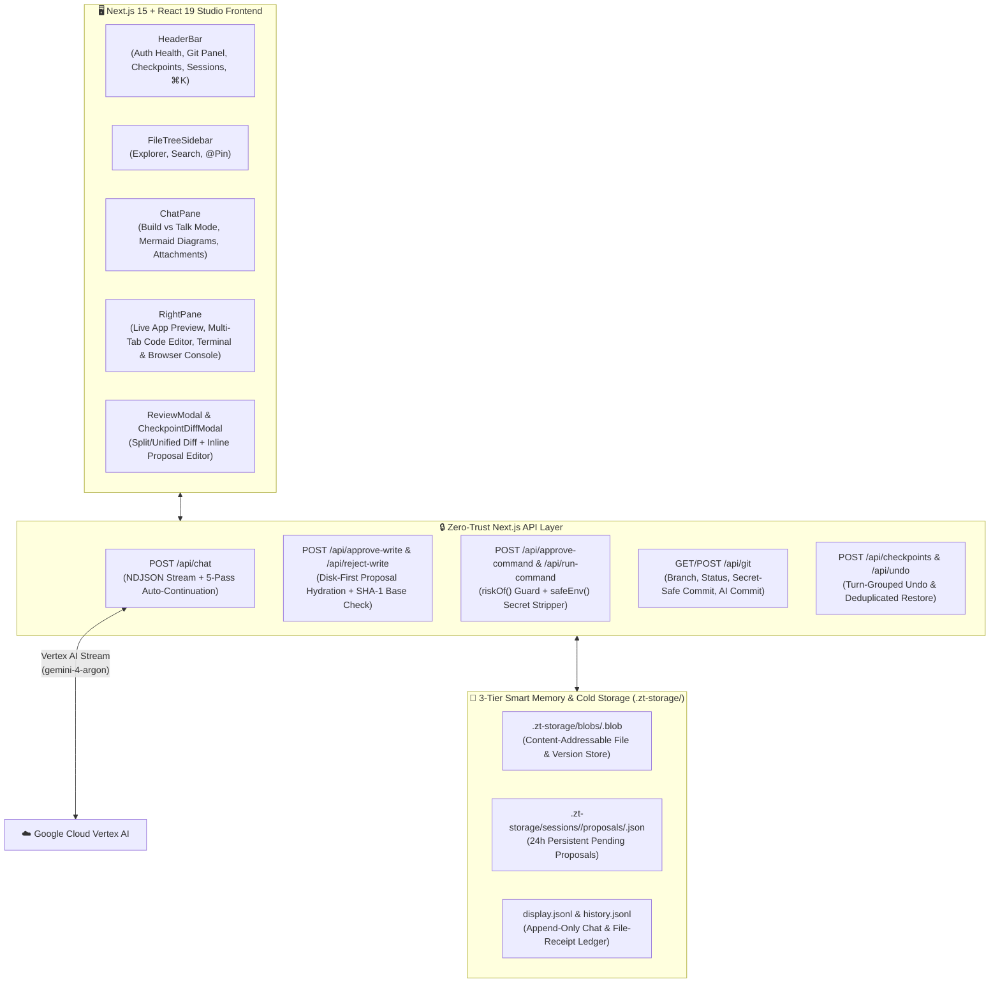

# 🛡️ Zero-Trust AI Studio (Next.js 15 + React 19 + Vertex AI)

A modular, full-stack **Zero-Trust AI App Builder & Sandbox IDE** built with **Next.js 15 (App Router)**, **React 19**, **Tailwind CSS**, and **Google Cloud Vertex AI (`@google/genai`)**.

Inspired by modern agentic coding environments like **Lovable**, **Bolt**, and **Cursor**, Zero-Trust AI Studio gives an LLM full-stack software engineering capabilities inside a **strictly permission-gated local workspace folder**—where **nothing is written to disk and no terminal command is executed without explicit developer review and approval**.

---

## 📑 Table of Contents

1. [Why Zero-Trust AI Studio?](#-why-zero-trust-ai-studio)
2. [System Architecture](#-system-architecture)
3. [Complete Feature Breakdown](#-complete-feature-breakdown)
4. [Quick Start: Installation & Running the Project](#-quick-start-installation--running-the-project)
5. [Environment Variables (`.env.example`)](#-environment-variables-envexample)
6. [How the Studio Works Under the Hood](#-how-the-studio-works-under-the-hood)
7. [Engineering Case Study: Problems Faced & How I Resolved Storage, RAM & Token Saving](#-engineering-case-study-problems-faced--how-i-resolved-storage-ram--token-saving)
8. [Automated Verification & Test Suite](#-automated-verification--test-suite)

---

## 🎯 Why Zero-Trust AI Studio?

Most AI coding agents either:
- Run unrestricted shell commands and overwrite files silently on disk (risking broken builds, deleted code, or leaked `.env` / cloud credentials), **or**
- Lose context after 6–10 turns because they stuff full 10,000-byte code files into RAM and chat history on every turn.

**Zero-Trust AI Studio solves both problems:**
1. **Strict Zero-Trust Sandbox**: The AI is locked to a single user-selected project folder. Every proposed file creation, modification, deletion, or terminal command is intercepted into a **GitHub-style Split/Unified Diff Review Modal** with inline code editing, critical-change guardrails, and 1-click multi-file Undo.
2. **3-Tier Smart Memory & Content-Addressable Disk Engine (`.zt-storage/`)**: Uses SHA-1 deduplicated blobs on disk, RAM dehydration, and **File-Receipt History Compaction** to cut prompt token usage by **75–90%** and keep Node.js RAM usage flat—even across 15+ turn coding sessions.

---

## 🏗️ System Architecture



---

## ✨ Complete Feature Breakdown

### 1. 🛡️ 5-Layer Zero-Trust Security Sandbox
- **Workspace Jail (`safeResolve`)**: Blocks path traversal (`..`), absolute paths, system folders (`/etc`, `C:\Windows`), reserved Windows device names, and broken or active **symbolic links** (`fs.lstatSync` + `fs.realpathSync` verification on every path segment).
- **Multi-Layer Secret & Credential Protection**:
  - `vertex_credentials.json`, `.env`, `.env.local`, and `.env.*` (except `.env.example`) can **never** be read into snapshots, searched, opened in the editor, overwritten, deleted, or accessed via terminal commands.
  - Every workspace `.gitignore` is automatically enforced to contain `vertex_credentials.json` and `.env*`.
  - Before any `git commit`, `unstageProtectedSecrets()` explicitly unstages secret files so credentials can never be committed or pushed to GitHub.
- **Terminal Command Firewall (`riskOf` & `safeEnv`)**:
  - Blocks multiline command injection, `sudo`, recursive `rm -rf`, encoded PowerShell/bash pipelines, raw network tools (`nc`, `socat`), and `git push/remote/config`.
  - Strips all `KEY`, `TOKEN`, `SECRET`, `CREDENTIAL`, `GOOGLE_*`, `GCP_*`, and `PORT`/`STUDIO_PORT` environment variables from child processes so sandboxed dev servers never leak secrets or collide with the Studio's port (`3005`).

### 2. 👀 GitHub-Style Diff Reviewer & Inline Proposal Editor
- **Split (Side-by-Side) & Unified Diff Views**: Word-level diff highlighting, expandable unchanged line gaps, and `j` / `k` keyboard navigation across proposed files.
- **Inline Proposal Editing**: Tweak or edit the AI's proposed code directly inside the Review Modal before clicking **Approve & Write**; the Studio automatically marks the file for delta sync so the AI sees your exact edits on the next turn.
- **Stale File Conflict Detection**: Verifies the on-disk SHA-1 `baseHash` before writing so external edits are never silently clobbered.
- **Critical Architecture & Deletion Guard**: Highlights destructive deletions or core config changes (`package.json`, `tsconfig.json`, `next.config.*`) with a `⚠️ CRITICAL` badge and optional pre-confirmation pause.

### 3. 💬 Dual AI Modes: **Build Mode** vs. **Talk & Architecture Mode**
- **🔨 Build Mode**: Proposes complete, production-ready files (`<file_zt...>`), deletions (`<delete_zt...>`), and terminal commands (`<cmd_zt...>`), plus append-only `CHANGELOG.md` entries.
- **💬 Talk / Plan Mode**: Brainstorm system design, debug issues, and review trade-offs without queuing file changes. Automatically renders interactive **Mermaid.js architecture diagrams** (`flowchart`, `sequenceDiagram`, etc.) with zoom/pan controls and raw source inspection.

### 4. 🖥️ Full IDE Workspace: Multi-Tab Code Editor, Live Preview & Dual Consoles
- **Docked Multi-Tab Code Editor**: Synchronized line-number gutter, dirty tab indicators (`•`), `Ctrl+S` / `Cmd+S` instant save, `Tab` indentation, and `@Pin` to chat.
- **Live Responsive App Preview**:
  - Serves static HTML apps directly from `/api/preview/<sid>/` with automatic `<base>` tag injection and root-relative asset rewriting.
  - Automatically detects running dev servers (`http://localhost:3000`, `5173`, etc.) from terminal output and switches the preview iframe to the live server URL.
  - Includes **Desktop (100%)**, **Tablet (768px)**, and **Mobile (375px)** viewport presets.
- **Server Terminal + Browser Runtime Console Bridge**:
  - Captures `console.error`, `console.warn`, `window.onerror`, and `unhandledrejection` from inside the preview iframe and provides a **1-Click "🩹 Fix Browser Errors with AI"** button.
  - Optional **🔄 Auto-Verify (`npx tsc --noEmit`)** and **🤖 Auto-Heal (1-Retry)** loop that automatically verifies TypeScript compilation after file approval and asks the AI to self-heal compiler errors.

### 5. 🌿 Interactive Git Source Control & Deduplicated Checkpoints
- **Git Source Control Panel**: Initialize repos (`git init`), switch/create branches, inspect uncommitted changes, stage & commit with automatic secret unstaging, or click **✨ AI Commit** to generate a Conventional Commit command from `git diff`.
- **SHA-1 Deduplicated Checkpoints & Turn-Grouped Undo**:
  - Save named workspace checkpoints stored in `.zt-storage/blobs/` with side-by-side comparison (`CheckpointDiffModal`) before restoring.
  - **1-Click Undo (`↩️`)** reverses all file writes from the latest turn as a single atomic batch.

### 6. 🔔 Web Audio Synthesizer Chimes, Desktop Notifications & Command Palette (`⌘K`)
- Zero-dependency **Web Audio API** synthesized completion chimes (ascending major arpeggio for Build, warm 2-note chime for Talk, low double-tone for Error), background tab title flashing, and OS Desktop Notifications.
- **Command Palette (`Ctrl+K` / `Cmd+K`)** for instant file opening, `@file` pinning, terminal macros, and window layout toggles.

---

## 🚀 Quick Start: Installation & Running the Project

### Prerequisites
- **Node.js** `v18.18+` or `v20+` / `v22+`
- A **Google Cloud Project** with the **Vertex AI API** enabled and a Service Account JSON key.

### Step 1: Clone & Install Dependencies
```bash
npm install
```

### Step 2: Configure Environment Variables (`.env`)
Copy `.env.example` to `.env` in the root folder:
```bash
cp .env.example .env
```
Open `.env` and fill in your Google Cloud Service Account details (or place `vertex_credentials.json` in the project root).  
> 💡 **Built-in OpenSSL Self-Healing**: Zero-Trust Studio automatically repairs common `.env` copy-paste issues (escaped newlines, extra quotes, trailing JSON commas) and verifies real `RSA-SHA256` JWT signing via Node's OpenSSL 3 `crypto` module. You can verify your key anytime using the **🔑 `.env Ready`** badge in the top bar!

### Step 3: Start the Development Server
```bash
npm run dev
```
- The smart port launcher (`scripts/start-next.mjs`) checks if port **3005** is free across IPv4/IPv6 (and automatically increments to `3006+` if busy).
- Open **`http://localhost:3005`** in your browser.

### Step 4: Production Build & Verification
```bash
# Run the 8-part automated verification suite
npm test

# Run TypeScript compiler verification
npx tsc --noEmit

# Build & start for production
npm run build
npm start
```

---

## 🔑 Environment Variables (`.env.example`)

| Variable | Required | Default | Description |
| :--- | :---: | :---: | :--- |
| `GOOGLE_PROJECT_ID` / `GCP_PROJECT` | ✅ | — | Your Google Cloud Project ID where Vertex AI is enabled. |
| `GOOGLE_CLIENT_EMAIL` | ✅* | — | Service Account email (`...@....iam.gserviceaccount.com`). |
| `GOOGLE_PRIVATE_KEY` | ✅* | — | Service Account RSA PEM private key (single-line with `\n`). |
| `GOOGLE_PRIVATE_KEY_ID` | Optional | — | Private key ID from your Service Account JSON. |
| `GOOGLE_SERVICE_ACCOUNT_JSON` | Optional | — | Alternative: full single-line Service Account JSON string. |
| `GOOGLE_APPLICATION_CREDENTIALS` | Optional | `./vertex_credentials.json` | Alternative: path to your Service Account JSON file. |
| `GCP_LOCATION` | Optional | `global` | Vertex AI region (e.g., `global`, `us-central1`). |
| `MODEL` | Optional | `gemini-4-argon` | Default Vertex AI model (`gemini-4-argon`, `gemini-2.5-pro`, etc.). |
| `PORT` | Optional | `3005` | Studio HTTP port (auto-finds next open port if busy). |
| `CONTEXT_CHAR_BUDGET` | Optional | `800000` | Max character budget before automatic snapshot refresh. |
| `MAX_OUTPUT_TOKENS` | Optional | `65536` | Max output tokens per streaming pass. |

*\*Required unless using `GOOGLE_SERVICE_ACCOUNT_JSON` or `vertex_credentials.json`.*

---

## ⚙️ How the Studio Works Under the Hood

1. **Workspace Lock (`POST /api/lock`)**:
   - Validates your chosen folder path and checks `.zt-storage/sessions/` (`findLatestSessionByRoot`). If you worked on that folder previously within the 24-hour TTL window, it **automatically restores your chat history, undo stack, and checkpoints**.
2. **Initial Snapshot & Incremental Deltas (`src/lib/workspace.ts`)**:
   - On Turn #1, `buildSnapshot()` walks the workspace (ignoring `node_modules`, `.git`, `.zt-storage`, binaries, and secrets) and prioritizes config files (`package.json`, `tsconfig.json`) followed by `src/`.
   - On Turn #2+, `buildDelta()` compares file `mtimeMs:size` signatures against `s.seen` and sends **only externally modified or newly created files**, plus any files mentioned by name in your prompt (`buildOnDemandCodebaseContext`).
3. **Per-Process Randomized XML Tags (`TAG_KEY`)**:
   - Every server boot generates a random cryptographic suffix (`file_zt<hex>`, `delete_zt<hex>`, `cmd_zt<hex>`) so code files containing XML/HTML tags in the workspace can never collide with or spoof AI proposal tags.
4. **5-Pass Seamless Tail-Append Auto-Continuation (`src/app/api/chat/route.ts`)**:
   - If a large multi-file generation hits the output token cap or stops mid-file (`findUnclosedFileTag`), the server automatically feeds the last 1,200 characters (`<<<TAIL_START>>>...<<<TAIL_END>>>`) back to the model for up to 5 continuation passes and stitches the output seamlessly (`stitchContinuation`).

---

## 🧠 Engineering Case Study: Problems Faced & How I Resolved Storage, RAM & Token Saving

> 📂 **Full Deep-Dive Available in [`./problems_faced/`](./problems_faced/01_Storage_RAM_And_Token_Optimization_Case_Study.md)**  
> Read [`problems_faced/01_Storage_RAM_And_Token_Optimization_Case_Study.md`](./problems_faced/01_Storage_RAM_And_Token_Optimization_Case_Study.md) for the complete architectural breakdown, metrics, and code-level walk-through.

During real-world stress testing (building a 30+ file Greedy Algorithms curriculum across 14+ turns), we encountered **four major production challenges** and engineered permanent solutions for each:

### Problem 1: Prompt Token Explosion (94,459 Prompt Tokens by Turn 14) & Cache Invalidations
- **What Happened**: Every turn in `s.history` stored the full 8,000–10,000 byte `<file_...>` bodies of all files generated in previous turns. By Turn 14, a single message consumed **94,459 prompt tokens** (over **954,000 cumulative tokens**), and shifting the history compaction window by 1 turn on every message invalidated Vertex AI's prefix cache (`cached` dropped from `88,388` to `0`).
- **How We Solved It**:
  1. **File-Receipt History Compaction (`compactModelTurnForHistory`)**: When saving a model turn to `s.history` (or loading `history.jsonl`), bulky `<file_...>` bodies are replaced with compact **1-line File Receipts** containing the file path, byte size, and top markdown headings/exported symbols:
     ```text
     [WORKSPACE FILE SAVED: greedy_new/08_Greedy_Stack/_1_Remove_K_Digits.md (8,347 bytes) | Outline: # 1. Remove K Digits → ## Core Intuition → ## Dry Run → ## Java/C++/Python Code]
     ```
     This reduced per-turn history size by **~95%** while keeping 100% of file awareness, syllabus progress, and section structure.
  2. **Automatic On-Demand Codebase & Version Loader (`buildOnDemandCodebaseContext`)**: Instead of re-sending all files in history, the server sends a live Workspace File Tree (flagging any `<900 byte` stub files) and automatically loads the full disk content of **any file mentioned in the user's prompt** (plus its previous version from `undo.json` -> `.zt-storage/blobs/` when asked to compare/revert).
  3. **4-Turn Block Compaction & Delta-Only `CHANGELOG.md`**: Older history turns compact in stable 4-turn blocks to preserve Vertex AI's **75% Context Cache**, and the AI emits **only the new `## ...` section** for `CHANGELOG.md` (which `mergeChangelogAppendOnly()` prepends on disk).

### Problem 2: Node.js RAM Bloat Across Multi-Session Workspaces
- **What Happened**: Keeping `s.snapshot.text` (up to 400 KB), `p.content` / `p.oldContent` for every pending proposal, and full undo snapshots in Node.js RAM caused memory usage to grow linearly with every turn and checkpoint.
- **How We Solved It**:
  - **Content-Addressable Cold Storage (`.zt-storage/blobs/<sha1>.blob`) & RAM Dehydration (`dehydrateSessionInRam`)**: Every file version, checkpoint, undo item, and proposal body is hashed with SHA-1 and written once to `.zt-storage/blobs/`. Immediately after streaming `{ t: "done" }` to the browser, `dehydrateSessionInRam()` strips `p.content`, `p.oldContent`, and `s.snapshot.text` from Node.js RAM—leaving only 40-byte SHA-1 pointers in memory and hydrating from disk on demand.

### Problem 3: `"Proposal expired or not found"` When Approving Files After Reading
- **What Happened**: While spending 15–30 minutes reading generated tutorials before clicking **Approve**, Next.js dev workers could reload or run `/api/approve-write` in a worker whose in-memory `s.pendingChanges` map was empty. Even worse, `saveSessionToDisk()` previously had a cleanup loop that unlinked `proposals/*.json` on disk if `s.pendingChanges` was empty in RAM, and background GC deleted unreferenced blobs after 5 minutes.
- **How We Solved It**:
  - **Disk-First Proposal Hydration (`loadProposalFromDisk` & `syncProposalsFromDisk`)**: `/api/approve-write`, `/api/reject-write`, and `/api/state` now automatically fall back to `.zt-storage/sessions/<sid>/proposals/<id>.json` and `.zt-storage/blobs/` on disk if a proposal is missing from RAM.
  - **24-Hour Proposal & Blob Retention**: Removed the destructive unlink loop in `saveSessionToDisk()` and aligned orphan blob cleanup with the full **24-hour `SESSION_TTL_MS`**.

### Problem 4: Mid-File Truncation at `Thinking Process: ... close \`</file_zt...>\``
- **What Happened**: During auto-continuation passes, reasoning models occasionally emitted `part.thought === true` or plain-text `Thinking Process:` notes that mentioned the closing tag in inline backticks (e.g., ``1. Continue file..., close `</file_zt...>` ``). The old `FILE_RE` regex matched `` `</file_zt...>` `` inside the sentence as the end of the file, cutting off the file at 8 lines!
- **How We Solved It**:
  1. Added `extractVisibleChunkText()` in `/api/chat` to filter out `part.thought === true` parts from `@google/genai` stream chunks.
  2. Added `stripThinkingPreamble()` in `src/lib/proposals.ts` to strip leaked `Thinking Process:` blocks at continuation seams.
  3. Hardened `FILE_RE` with negative lookbehind/lookahead for backticks (`(?<!\`)<\\/${FILE_TAG_PAT}>(?!\`)`) so inline code mentions like `` `</file_zt...>` `` never prematurely close a file.

---

## 🧪 Automated Verification & Test Suite

Run the built-in verification suite at any time with:
```bash
npm test
```
`scripts/verify-studio.mjs` verifies all 8 core invariants:
1. **Test 1**: Persistent image attachment binary storage, HTTP serving, and reset cleanup.
2. **Test 2**: Mid-stream Stop/Abort rollback preserving workspace deltas (`s.seen`) and terminal events (`s.events`).
3. **Test 3**: Multiline command guard, Studio port `3005` isolation, and static preview `<base>` rewriting.
4. **Test 4**: Vertex AI model configuration (`gemini-4-argon`) and `/api/auth-status` OpenSSL PEM health check.
5. **Test 5**: 5-layer protection of `vertex_credentials.json` & `.env*` across read/write/cmd/`.gitignore`/`git commit`.
6. **Test 6**: Path-bound session history auto-resume (`findLatestSessionByRoot`), JSONL self-healing, and Turn #1 undo cleanup.
7. **Test 7**: Backtick-safe `FILE_RE` & `stripThinkingPreamble()` preventing mid-sentence file truncation.
8. **Test 8**: Disk-first proposal persistence (`loadProposalFromDisk`), RAM dehydration (`dehydrateSessionInRam`), and File-Receipt history compaction.