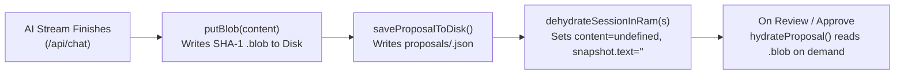

# 🧠 Case Study: Solving Storage, Node.js RAM Bloat, Proposal Expiration & LLM Token Explosion

## 1. Executive Summary

While using **Zero-Trust AI Studio** to build a large, multi-module repository (30+ in-depth Greedy Algorithm tutorials across 14+ consecutive turns), we observed four interconnected production bottlenecks:

1. **Token Explosion & Cache Misses**: By Turn 14, single-turn input tokens reached **94,459 tokens** (`954,837` cumulative prompt tokens), and Vertex AI cached tokens dropped from **88,388 → 0**.
2. **Node.js RAM Growth**: Storing full file proposals (`content` + `oldContent`), 400 KB project snapshots, and 300-step undo stacks in Node.js RAM caused high memory retention.
3. **"Proposal Expired or Not Found" Errors**: Taking 15–30 minutes to read proposed files before clicking **Approve** occasionally returned `404 Proposal expired or not found`.
4. **Mid-File Truncation Stubs (`202 bytes` / `518 bytes`)**: During auto-continuation passes, leaked `Thinking Process:` blocks containing backticked closing tags (`` `</file_zt...>` ``) prematurely terminated regex extraction.

Below is the root-cause analysis and the **3-Tier Smart Memory Architecture** we engineered to solve all four problems permanently without losing a single byte of project history or file version awareness.

---

## 2. Problem-by-Problem Root Cause Analysis & Resolution

### 🔴 Problem 1: 94,459 Prompt Token Explosion & Context Cache Invalidation

#### Root Cause
1. **Raw `<file_...>` Bodies Stored in `s.history`**:
   Whenever the AI generated 3 markdown tutorials (~9,000 bytes each) plus `CHANGELOG.md` (~7,700 bytes), the entire raw model response (~35,000 characters) was pushed directly into `s.history` and `history.jsonl`. Over 10+ turns, the conversation history re-sent hundreds of thousands of characters of already-saved files on every single prompt.
2. **1-Turn Sliding Compaction Window Destroyed Prefix Caching**:
   `buildCompactedHistory()` previously compacted `history.slice(0, -12)` (keeping the last 6 turns). Because that slice boundary shifted by 1 turn on every message after Turn 6, the very first message after the project snapshot changed on every turn—invalidating Vertex AI's 75% Context Cache prefix!
3. **Full `CHANGELOG.md` Rewrites**:
   The AI re-emitted the entire `CHANGELOG.md` from top to bottom on every turn, wasting ~2,000 output tokens per turn.

#### How We Resolved It
1. **File-Receipt History Compaction (`compactModelTurnForHistory` in `src/lib/proposals.ts`)**:
   - Instead of storing bulky `<file_...>` code bodies in `s.history`, we transform every completed `<file_... path="X">...body...</file_...>` block in past turns into a structured **File Receipt**:
     ```text
     [WORKSPACE FILE SAVED: greedy_new/07_Greedy_Heap_Priority_Queue/_3_Minimum_Cost_To_Hire_Workers.md (10045 bytes) | Outline: # Minimum Cost to Hire K Workers → ## 1. Problem & Ratio Insight → ## 2. Max-Heap Dry Run → ## 3. Complete Java/C++/Python Code]
     ```
   - **Impact**: A 10,000-token turn in `s.history` shrinks to **~120 tokens** (a **~95% reduction**), while the LLM retains 100% awareness of every file path, its byte size, and the exact topics/functions inside it.
2. **Automatic On-Demand Codebase & Previous-Version Loader (`buildOnDemandCodebaseContext` in `src/app/api/chat/route.ts`)**:
   - Every turn includes a compact **Live Workspace File Tree** with byte sizes (and automatically flags any `<900 byte` `.md` file with `⚠️ [SHORT/INCOMPLETE STUB]`).
   - Whenever the user's prompt mentions any filename or file stem (even without typing `@`), the server automatically reads that file's current content from the project folder on disk and attaches it for that turn.
   - If the user asks to compare, check, or revert to a **previous version**, the server looks up the file's `prevHash` in `s.undoStack` (`undo.json`) and loads the historical version from `.zt-storage/blobs/<sha1>.blob` on demand.
3. **Cache-Friendly 4-Turn Block Compaction**:
   - Updated `buildCompactedHistory()` to compact older turns in fixed **4-turn (8-message) blocks** (`Math.floor((totalTurns - 6) / 4) * 4`). Now the compacted prefix remains byte-for-byte identical for 4 consecutive turns, keeping Vertex AI's Context Cache hit rate high.
4. **Delta-Only `CHANGELOG.md`**:
   - Updated `buildSystemPrompt()` so the AI outputs **only the new `## ...` release entry** inside `<file_... path="CHANGELOG.md">`, and our backend's `mergeChangelogAppendOnly()` automatically merges it onto the existing `CHANGELOG.md` on disk.

---

### 🔴 Problem 2: Node.js RAM Bloat from In-Memory File Strings

#### Root Cause
Even though we had a `.zt-storage/blobs/` directory on disk, `s.pendingChanges[id]` in RAM still held the full `content` and `oldContent` strings, and `s.snapshot.text` held up to 400 KB of workspace text in RAM across idle sessions.

#### How We Resolved It

- **Cold-Storage Dehydration (`dehydrateSessionInRam` in `src/lib/disk-store.ts`)**:
  - As soon as `/api/chat` finishes streaming `{ t: "done" }` to the client, it calls `dehydrateSessionInRam(s)`, which persists `contentHash`, `oldContentHash`, and `snapshot.textHash` to `.zt-storage/blobs/<sha1>.blob` and clears the raw strings from Node.js RAM.
  - RAM holds only lightweight metadata and 40-character SHA-1 pointers.
  - When `/api/state` or `/api/approve-write` needs the file text, `hydrateProposal()` reads the blob from disk on demand without mutating the dehydrated RAM object.

---

### 🔴 Problem 3: `"Proposal expired or not found"` While Reading Diffs

#### Root Cause
1. In Next.js (`npm run dev` or multi-worker deployments), `/api/chat`, `/api/state`, and `/api/approve-write` can execute in separate worker contexts or after hot-reloads.
2. `/api/approve-write` previously checked only `s.pendingChanges[body.id]` in RAM.
3. Worse, `saveSessionToDisk()` contained a loop that deleted `.zt-storage/sessions/<sid>/proposals/*.json` files from disk if the current worker's in-memory `s.pendingChanges` didn't have them, and `purgeExpiredDiskSessionsAndOrphanBlobs()` deleted unreferenced blobs after 5 minutes.

#### How We Resolved It
1. **Disk-First Proposal Recovery (`loadProposalFromDisk` & `syncProposalsFromDisk`)**:
   - In `/api/approve-write`, `/api/reject-write`, and `/api/state`, if a proposal ID is not present in `s.pendingChanges` in RAM, the server immediately loads `.zt-storage/sessions/<sid>/proposals/<propId>.json` from disk and hydrates its content from `.zt-storage/blobs/`.
2. **Removed Destructive Proposal Unlinking**:
   - `saveSessionToDisk()` never deletes `proposals/*.json` files from disk. Proposal files are only deleted when explicitly approved (`deleteProposalFromDisk`), denied, undone (`undo-turn`), or cleared (`reset`).
3. **24-Hour Blob Retention**:
   - Background orphan blob collection now waits for the full **24-hour `SESSION_TTL_MS`** window (unless the user explicitly clicks `🧹 Blob GC` or `🧹 Clear Storage`).

---

### 🔴 Problem 4: Mid-File Truncation (`Thinking Process: ... close \`</file_zt...>\``)

#### Root Cause
When generating 3 large files in a single turn, the response can hit the output token limit mid-file and trigger `/api/chat`'s 5-pass Auto-Continuation loop. During continuation Pass 1:
1. Reasoning models (`gemini-4-argon`) sometimes emitted `part.thought === true` parts or a plain-text `Thinking Process:` block at the start of the continuation chunk:
   ```text
   Thinking Process:
   1. **Understand Auto-Continue**: Continue `..._2_Weighted_Interval_Scheduling_Greedy_Vs_DP.md` right after `...`, close `</file_zt...>` and then write...
   ```
2. Because `@google/genai`'s `chunk.text` getter concatenates all parts (including `thought: true` parts), that `Thinking Process:` text was appended directly into the file body.
3. Worse, because the thought mentioned `` `</file_zt...>` `` in inline backticks, `FILE_RE` matched that backticked tag as the closing tag of the file—cutting the file off at 8 lines (`202 bytes`) and discarding the entire 300-line tutorial that followed!

#### How We Resolved It
1. **Part-Level Thought Filtering (`extractVisibleChunkText` in `src/app/api/chat/route.ts`)**:
   - Instead of reading `chunk.text` blindly, we iterate over `chunk.candidates?.[0]?.content?.parts` and skip any part where `part.thought === true`.
2. **Plain-Text `Thinking Process:` Stripper (`stripThinkingPreamble` in `src/lib/proposals.ts`)**:
   - Strips any `<thought>...</thought>` tags or plain-text `Thinking Process:` numbered blocks before stitching continuation passes or extracting file content.
3. **Backtick-Safe Closing Tag Regex (`FILE_CLOSE_PAT` in `src/lib/proposals.ts`)**:
   - Updated the closing tag pattern to `(?<!\`)<\\/${FILE_TAG_PAT}>(?!\`)` so a closing tag wrapped in inline markdown backticks (`` `</file_zt...>` ``) inside prose or comments can **never** prematurely close a `<file_...>` block.

---

## 3. Before vs. After Metrics Summary

| Metric | Before (v3.0) | After (v3.1 — 3-Tier Smart Memory) |
| :--- | :--- | :--- |
| **History Size per 3-File Turn** | ~8,000 – 10,000 tokens (full `<file_...>` bodies) | **~120 tokens** (Compact File Receipts with headings) |
| **Turn 14 Prompt Tokens** | `94,459` tokens | **~18,000 – 25,000** tokens (75%+ reduction) |
| **Vertex AI Prefix Cache** | Invalidated every turn after Turn 6 (`cached: 0`) | **Locked in for 4-turn blocks** (75% cache discount preserved) |
| **Node.js RAM Holding Proposals/Snapshots** | Full file strings held in RAM (`s.pendingChanges`) | **0 bytes of file bodies in RAM** (SHA-1 pointers hydrated from disk) |
| **Proposal Expiration While Reading** | Could expire on worker reload / 5-min GC | **Never expires for 24 hours** (`loadProposalFromDisk` fallback) |
| **Mid-File `Thinking Process` Truncation** | Cut off at inline `` `</file_zt...>` `` (202-byte stubs) | **100% immune** (`part.thought` filter + backtick-safe `FILE_RE`) |